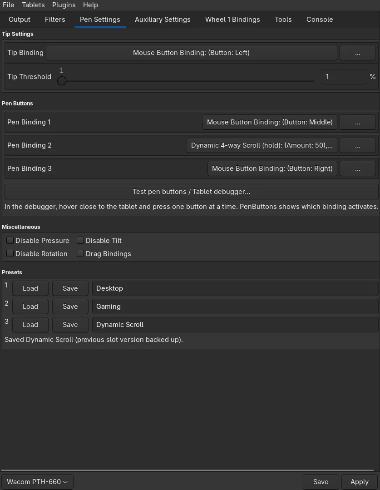

# Omarchy Wacom — NekoLegends

Better pen controls for a Wacom tablet on Omarchy/Hyprland Linux, built on top of
[OpenTabletDriver](https://opentabletdriver.net/).

Tested with the **Intuos Pro M (PTH-660)** over USB and the **Pro Pen 3D**. Other
tablets and pens might work, but nobody has checked them yet.



## What this actually does

OpenTabletDriver already drives your tablet. This adds the things we wanted and
couldn't get from the stock settings app:

- **Three ready-made setups you can switch between in one click.** Desktop,
  Gaming, and Dynamic Scroll. Each one is a row in Pen Settings with Load and
  Save buttons. Change something, hit Save, and the old version is backed up
  automatically. Your choices survive logout and reboot.
- **See which setup you're using and whether it's saved.** The settings window
  shows the setup's name and warns "Changes not saved" when you adjust it.
  Save on that setup's row to keep your changes.
- **Switch to pen mode and back without losing your mouse setup.** The mode
  button remembers your current mouse controls and scrolling settings, then
  brings them back when you return. It no longer loads an older Mouse setup.
- **Hold one pen button to scroll in any direction.** Hold the button, and
  wherever your pen is pointing becomes the "centre". Push up to scroll up,
  down to scroll down, sideways for sideways. The further you push, the faster
  it scrolls. Diagonals work too. Let go and everything goes back to normal —
  no cursor jump.
- **All three buttons on the Pro Pen 3D work properly.** The third button is a
  real, separate button you can bind to anything (right-click by default).
- **A pen-button tester built in.** Not sure which button is which? Open the
  debugger, hover over the tablet, press one button at a time, and it tells you
  in plain words: "Pressed: Pen Binding 3".
- **No more cursor teleports when you lift the pen.** The stock hover-distance
  filter can snap the cursor to the corner of your screen. Ours doesn't.

## Before you start

You need **OpenTabletDriver 0.6.8 already installed and working** — tablet
detected, pen moving the cursor. On Omarchy that's:

```bash
omarchy pkg aur add opentabletdriver
```

If the tablet doesn't work yet, follow
[OpenTabletDriver's Linux guide](https://opentabletdriver.net/Wiki/Install/Linux)
first. This project doesn't touch the system driver; it only changes the
settings app and adds plugins.

## Install

```bash
git clone https://github.com/neko-legends/omarchy-wacom.git
cd omarchy-wacom
./scripts/build
./scripts/test

# Close the settings app first. The background driver can stay running.
./scripts/install --pro-pen-3d
wacom
```

That's it. `wacom` opens the settings app (there's also a launcher entry).
No sudo needed for the install, your existing settings are backed up, and on a
fresh install all three presets are filled in for you with **Dynamic Scroll**
active.

Only pass `--pro-pen-3d` if you actually have that pen — it changes how the
buttons are decoded. Without the flag, no pen-specific override is installed.

## The three presets

| Preset | Button 1 | Button 2 | Button 3 |
|---|---|---|---|
| Desktop | Vertical scroll | Scroll the other way | Right-click |
| Gaming | Middle-click | Mouse "back" button | Right-click |
| Dynamic Scroll (default) | Middle-click | **Hold for four-way scroll** | Right-click |

Click **Load** on a row to use it. If you've made unsaved changes, it asks
first so you don't lose them. These presets are stored in
`~/.config/OpenTabletDriver/QuickPresets/` and are separate from the File
menu's named presets. "Saved" in the new label means saved to one of these
three rows, not just saved for startup.

The installer updates the old Pen/Mouse switching buttons to remember your
setup. Other buttons that load named presets are left alone. If you haven't
used a mouse setup yet, switching back from pen mode uses Dynamic Scroll.
Apply or save changes before switching modes so the driver can remember them.

### Tuning the scroll feel

In Pen Settings, click the **…** next to Pen Binding 2 (the scroll binding).
Defaults: dead zone 10 px, speed ramps up over the next 50 px, max 5× speed.
Horizontal scrolling only works in apps that support it.

For scrolling to work, the **Dynamic 4-way Scroll companion** filter must be
enabled under **Filters**, below **Relative Mouse Hover Cutoff**. The supplied
preset already sets this up. Don't use these mouse filters in Artist mode.

## Keeping it working

Builds are pinned to OpenTabletDriver **0.6.8** (the source archive is
checksum-verified). If you upgrade the system driver past that, rebuild and
re-check this customization — it isn't automatically rebased onto newer
OpenTabletDriver code.

## For developers

```bash
./scripts/test    # real output-pipeline, button states, presets, debugger
./scripts/build   # downloads pinned upstream, applies upstream-overlay/
```

Make GUI changes in `upstream-overlay/`, never in the generated
`OpenTabletDriver-0.6.8/` folder. `scripts/bootstrap` reapplies the overlay.
Design details, limitations and rollback: [docs/architecture.md](docs/architecture.md).

## License and credits

LGPL-3.0-or-later — see [LICENSE](LICENSE) and [NOTICE](NOTICE). All credit for
the underlying driver goes to the OpenTabletDriver project. These
customizations and this documentation were AI-assisted.
